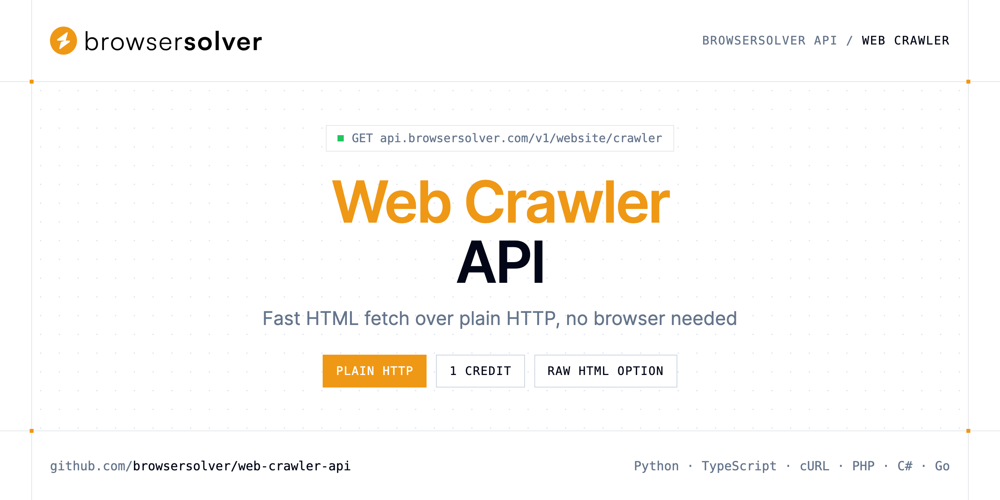

<p align="center">
  <a href="https://www.browsersolver.com"></a>
</p>

# Web Crawler API

[](https://discord.gg/CFj3ph8aHU) [](https://app.browsersolver.com/register) [](https://app.browsersolver.com/openapi) [](LICENSE)

The **BrowserSolver Web Crawler API** is a fast HTTP pull of public HTML without a browser session. It is the right tier when the first response already contains the content you need.

- **Web Crawler API** — Fast HTTP pull of public HTML with no browser session.

Use it for static and server-rendered pages: blogs, documentation, catalogs, news or any SSR site.

| Endpoint | Request | Credits |
|---|---|---|
| [Web Crawler API](#web-crawler-api) | `GET /v1/website/crawler` | 1 |

## Table of contents

- [How it works](#how-it-works)
- [Web Crawler API](#web-crawler-api)
- [Code examples in other languages](#code-examples-in-other-languages)
- [Use cases](#use-cases)
- [Why BrowserSolver?](#why-browsersolver)
- [FAQ](#faq)
- [Related repositories](#related-repositories)
- [Support](#support)

## How it works

1. **Create a BrowserSolver account** and copy your API key from the [dashboard](https://app.browsersolver.com/register).
2. **Call `https://api.browsersolver.com`** with the header `x-api-key: YOUR_API_KEY`.
3. **Use the result** in your app — no infrastructure to run.

```bash
export BROWSERSOLVER_API_KEY="your-api-key"
pip install requests        # Python
# TypeScript: Node.js 18+ (native fetch), run with `npx tsx file.ts`
```

## Web Crawler API

Fast HTTP pull of public HTML with no browser session. Ideal when the first response already contains the content you need.

`GET https://api.browsersolver.com/v1/website/crawler` · **1 credit per request** · [API reference](https://app.browsersolver.com/openapi)

### Request parameters

| Parameter | In | Type | Required | Description |
|---|---|---|---|---|
| `query` | query | string | ✅ | Public URL to retrieve with the Crawler tier (plain HTTP, no JavaScript). Include `http://` or `https://`. |
| `allow_redirects` | query | boolean | — | Whether BrowserSolver should chase HTTP redirects for this fetch. |
| `return_page_source` | query | boolean | — | Choose between processed markup and the exact bytes from the origin. |

### Python example

```python
import os

import requests

API_KEY = os.environ["BROWSERSOLVER_API_KEY"]
HEADERS = {"x-api-key": API_KEY}

response = requests.get(
    "https://api.browsersolver.com/v1/website/crawler",
    headers=HEADERS,
    params={
        "query": "https://books.toscrape.com/",
    },
    timeout=120,
)
response.raise_for_status()

data = response.json()
print(data)
```

### TypeScript example

```typescript
type WebCrawlerApi = string;

const headers = { "x-api-key": process.env.BROWSERSOLVER_API_KEY!, "Content-Type": "application/json" };

const params = new URLSearchParams({
  "query": "https://books.toscrape.com/",
});

const response = await fetch(`https://api.browsersolver.com/v1/website/crawler?${params}`, { headers });
if (!response.ok) throw new Error(`HTTP ${response.status}: ${await response.text()}`);

const data = (await response.json()) as WebCrawlerApi;
console.log(data);
```

### Output example

Example response from the API reference, abridged.

```json
"<!DOCTYPE html><html lang=\"en\"><head><meta charset=\"utf-8\"><title>Welcome to Python.org</title><meta name=\"viewport\" content=\"width=devic…"
```

## Code examples in other languages

Ready-to-run examples live in [`examples/`](examples); each reads your key from `BROWSERSOLVER_API_KEY`.

| Language | `crawler` |
|---|---|
| cURL (Bash) | [crawler.sh](examples/curl/crawler.sh) |
| PHP | [crawler.php](examples/php/crawler.php) |
| C# | [Crawler.cs](examples/csharp/Crawler.cs) |
| Go | [crawler.go](examples/go/crawler.go) |
| Java | [CrawlerExample.java](examples/java/CrawlerExample.java) |
| Ruby | [crawler.rb](examples/ruby/crawler.rb) |
| Node.js | [crawler.mjs](examples/nodejs/crawler.mjs) |

## Use cases

- **Static & SSR sites** — Fetch server-rendered pages at the lowest cost.
- **Link discovery** — Pull category and listing pages to find URLs to process next.
- **Redirect inspection** — Stop on the first response with `allow_redirects=false`.
- **Exact source** — Get the untouched HTML from the server with `return_page_source=true`.

## Why BrowserSolver?

- **Three fetch tiers** — Crawler for static HTML, Rendering for JavaScript pages, WebUnlocker for hosts that still challenge a headless browser.
- **Know before you fetch** — the Antibot endpoint names the bot-protection vendor in front of a URL so you can choose the right tier.
- **Screenshots as a service** — PNG, JPEG, WebP or PDF, full page, 18 device presets, cookie banner and ad removal, S3 upload.
- **Technology detection** — CMS, frameworks, analytics, CDN and security tooling of any public URL.
- **Copy-paste examples** — Python and TypeScript in each README, 7 more languages in `examples/`.

## FAQ

### How do I authenticate?

Create an account on [BrowserSolver](https://app.browsersolver.com/register), copy your API key and send it in the `x-api-key` header of every request to `https://api.browsersolver.com`.

### How much does a request cost?

Credits per call: `/v1/website/crawler` **1**. See [BrowserSolver pricing](https://www.browsersolver.com/pricing).

### Does the Crawler run JavaScript?

No. It is plain HTTP; use the JavaScript Rendering API for pages that need scripts.

### Which languages are supported?

Any language that can make an HTTP request. This README shows Python and TypeScript; the [`examples/`](examples) folder contains cURL, PHP, C#, Go, Java, Ruby and Node.js.

## Related repositories

- [Web Unlocker API](https://github.com/browsersolver/web-unlocker-api)
- [JavaScript Rendering API](https://github.com/browsersolver/javascript-rendering-api)
- [Screenshot API](https://github.com/browsersolver/screenshot-api)
- [Antibot Detection API](https://github.com/browsersolver/antibot-detection-api)
- [Website Technology API](https://github.com/browsersolver/website-technology-api)
- [All BrowserSolver repositories](https://github.com/browsersolver)

## Support

- 💬 Join the [Discord](https://discord.gg/CFj3ph8aHU) to ask questions and share what you build.
- 📚 Read the [API reference](https://app.browsersolver.com/openapi).
- 🔑 [Get your API key](https://app.browsersolver.com/register).

---

<p align="center">
  <a href="https://www.browsersolver.com">
    <picture>
      <source media="(prefers-color-scheme: dark)" srcset="images/logo-dark.svg">
      
    </picture>
  </a>
  <br>
  <sub>Built by <a href="https://www.browsersolver.com">BrowserSolver</a>. Examples are released under the MIT license.</sub>
</p>
